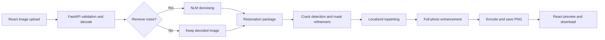
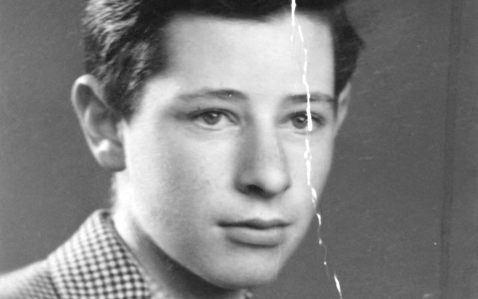
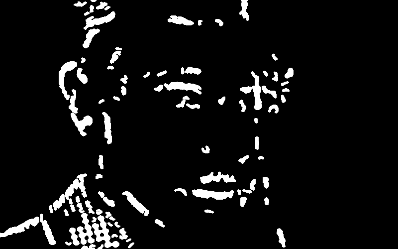
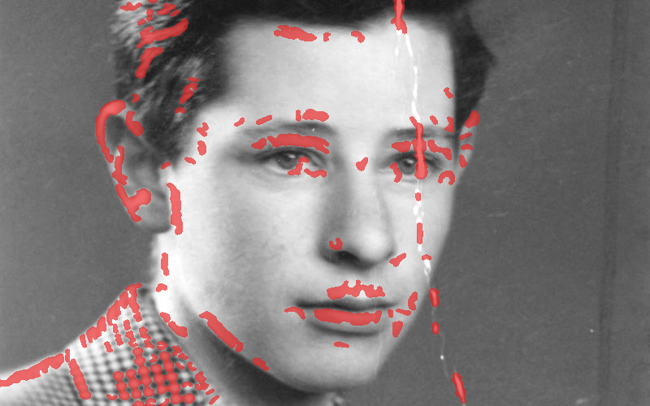

# Photo Restoration using Digital Image Processing

A browser-based photo-restoration project that detects candidate scratches and
cracks, refines a damage mask, and repairs the masked areas with classical image
processing. The React frontend uploads a photograph to a FastAPI backend and
shows the returned PNG beside the original.

> **Project status:** The complete upload-to-result flow is connected. Damage
mask quality is still an active limitation: portrait and fabric texture can be
marked as damage, while faint or fragmented scratches can be missed.

## Key features

- Upload JPEG, PNG, and WebP photographs and preview the original.
- Optionally run light Non-Local Means (NLM) denoising before damage detection.
  Denoising is off by default.
- Detect crack-like regions, refine a binary mask, and inpaint masked pixels.
- Apply fading correction, color balance, and sharpening after restoration.
- Preview and download the restored PNG in the browser.
- Save a uniquely named copy of each successful API result under
  `Backend/outputs/` for local review.

## Architecture



## Sample restoration

The figures below show the sample portrait used during development. They also
show the current detector's limitation: the mask includes some normal portrait
texture, so inpainting can soften details outside the scratch.

<table>
  <tr>
    <th>Input photograph</th>
    <th>Binary damage mask</th>
  </tr>
  <tr>
    <td></td>
    <td></td>
  </tr>
  <tr>
    <th>Detected damage overlay</th>
    <th>Restored result</th>
  </tr>
  <tr>
    <td></td>
    <td></td>
  </tr>
</table>

## Technologies

- **Frontend:** React, React Router, Vite, JavaScript, CSS
- **Backend:** Python, FastAPI, Uvicorn, multipart form uploads
- **Image processing:** OpenCV, NumPy, Pillow, scikit-image
- **Source control:** Git and GitHub

## Run the complete application

You need Python, Node.js, and npm. Start the backend and frontend in separate
terminals.

### 1. Start FastAPI

```powershell
cd Backend
python -m venv .venv
.\.venv\Scripts\Activate.ps1
python -m pip install -r requirements.txt
python -m uvicorn main:app --reload --host 127.0.0.1 --port 8000
```

The backend API is at `http://127.0.0.1:8000`. Interactive API documentation is
at `http://127.0.0.1:8000/docs`.

### 2. Start the React app

In a second terminal:

```powershell
cd Frontend
npm install
npm run dev
```

Open the local Vite URL shown in the terminal, usually
`http://localhost:5173`. The editor currently sends requests to
`http://127.0.0.1:8000`; if you change that address, update the API URL in
`Frontend/src/components/Editor.jsx` and the allowed origins in
`Backend/main.py`.

## Repository guide

- `Frontend/` — React pages and the image editor.
- `Backend/main.py` — FastAPI routes, upload validation, PNG response, and local
  output saving.
- `Backend/pipeline.py` — checkbox-controlled denoising, restoration, and
  enhancement orchestration.
- `Backend/image_processor.py` — denoising algorithms; the API uses NLM when
  the user selects noise removal.
- `Backend/Restoration/` — crack detection, mask refinement, inpainting, and
  image enhancement.
- `Backend/test_images/` — sample input photographs for development.
- `Backend/outputs/` — generated restoration results; ignored by Git except for
  `.gitkeep`, which preserves the empty folder in a fresh checkout.
- `Poster/` — project poster, source, preview, and its image assets.

For component-specific setup, see [Frontend/README.md](Frontend/README.md) and
[Backend/README.md](Backend/README.md).
